<a href="https://camilbenameur.com">
  <picture>
    <source media="(prefers-color-scheme: dark)" srcset="assets/hero-dark.svg">
    
  </picture>
</a>

 

 

**Software engineer in Lyon · available now · open to software and AI engineering roles, in Lyon or remote (France).**

 

<a href="https://github.com/camilbenameur/guarded-messaging-agent"><picture><source media="(prefers-color-scheme: dark)" srcset="assets/card-guarded-messaging-agent-dark.svg"></picture></a>
<a href="https://github.com/camilbenameur/go-llm-stream"><picture><source media="(prefers-color-scheme: dark)" srcset="assets/card-go-llm-stream-dark.svg"></picture></a>
<a href="https://github.com/camilbenameur/gatehaul"><picture><source media="(prefers-color-scheme: dark)" srcset="assets/card-gatehaul-dark.svg"></picture></a>
<a href="https://github.com/camilbenameur/remote-devbox-skill"><picture><source media="(prefers-color-scheme: dark)" srcset="assets/card-remote-devbox-skill-dark.svg"></picture></a>

 

**Stack** · Go · Python · TypeScript / React · Docker / Podman · GitHub Actions · PostgreSQL · Linux · LLM APIs, MCP, RAG, testing

**Contact** · [LinkedIn](https://www.linkedin.com/in/camil-benameur-14a762194) · [camilbenameur.com](https://camilbenameur.com/#contact) · [Blog](https://blog.camilbenameur.com)
